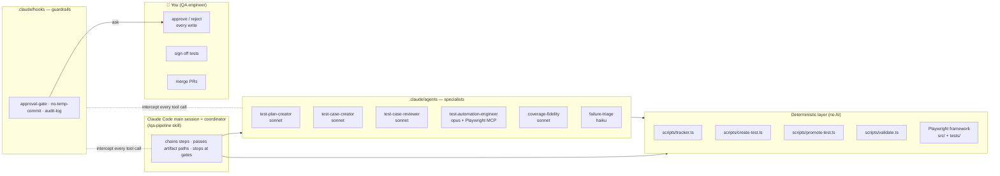
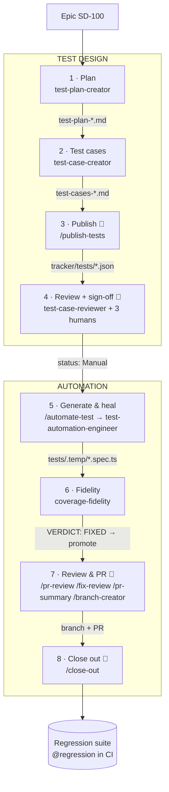
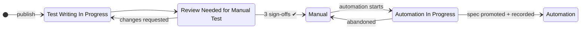
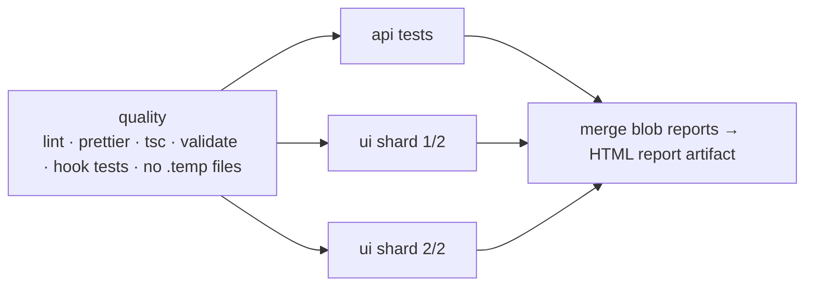

# How the framework works

> **One-sentence version:** specialist AI agents draft, research and check; deterministic scripts do the
> bookkeeping; guard hooks make sure a **human approves every write**; and every hand-off between steps is a
> **file** you can read, diff and review.

This document explains the architecture from the outside in. Read it top to bottom once, then use
[WALKTHROUGH.md](WALKTHROUGH.md) to operate it hands-on.

---

## 1. The big picture



There are **four layers**, and knowing which layer owns what is the key to "controlling" the framework:

| Layer | Lives in | Owns | Can it be wrong? |
|---|---|---|---|
| **Test framework** | `src/`, `tests/`, `playwright.config.ts` | Page objects, fixtures, data, specs | Only if code is wrong; fully deterministic |
| **Deterministic scripts** | `scripts/` | Tracker state machine, scaffolding, promotion gate, validation | No: same input → same output |
| **AI agents & skills** | `.claude/agents`, `.claude/skills` | Reading requirements, drafting, exploring the app, writing/healing code, reviewing | **Yes**, which is why the other layers check them |
| **Guardrails** | `.claude/settings.json`, `.claude/hooks` | What any agent is *allowed* to do | Only if the guard code is wrong, so the guards have unit tests |

**Design principle:** use AI for judgment (what to test, how to automate, is this faithful?) and use
plain code for anything that must always be right (statuses, IDs, file moves, permissions).

---

## 2. The 8-step workflow



| # | Step | Who does it | Input → Output (the contract) | Human gate 🚦 |
|---|---|---|---|---|
| 1 | Plan | `test-plan-creator` | Epic → `artifacts/plans/test-plan-<EPIC>.md`, `traceability-<EPIC>.json`, `missing-acs-<EPIC>.json` | Read plan, decide to continue |
| 2 | Test cases | `test-case-creator` | Story → `artifacts/test-cases/test-cases-<STORY>.md` (with JSON blocks) | Read drafts |
| 3 | Publish | `/publish-tests` + `tracker publish` | Drafts → `tracker/tests/<ID>.json` (*Test Writing In Progress*) | **You pick** which drafts; approve each write |
| 4 | Sign-off | `test-case-reviewer` + **3 humans** | Tests → `artifacts/reviews/…-reviewed.md` → status **Manual** | Sign-offs are human-only (agents are blocked) |
| 5 | Generate & heal | `/automate-test` + `test-automation-engineer` | Manual test → green `tests/.temp/test-<ID>-<slug>.spec.ts` | Approve task + test moves |
| 6 | Fidelity | `coverage-fidelity` | Spec + tracker test → `artifacts/fidelity/fidelity-<ID>.md` (FIXED / PARTIALLY FIXED / BLOCKED) | Then `promote-test` (ESLint clean + green 3× required) |
| 7 | Review & PR | `/pr-review` → `/fix-review` → `/pr-summary` → `/branch-creator` | Code → `PR_REVIEW_<ID>.md`, `PR_SUMMARY_<ID>.md`, branch, PR | Approve the review, each git write; **humans merge** |
| 8 | Close out | `/close-out` | PR → task DONE + comment, test **Automation**, Slack post | Approve each write |

### Why "artifacts are the contract"
Each step writes a file and the next step reads it. This gives you:
- **Reviewability**: you can open `test-cases-SD-104.md` and judge it before anything happens.
- **Resumability**: a crashed or cancelled run continues from the last artifact.
- **Isolation**: each agent starts with a clean context. It gets a path, not the previous agent's whole conversation.
- **Auditability**: git history shows exactly what the AI produced and what humans changed.

---

## 3. Anatomy of an agent

An agent is more than a prompt. It has five parts (slide 5 of the course deck):

| Part | Where in this repo | Example |
|---|---|---|
| **Model** | `model:` in frontmatter | `opus` for code generation, `sonnet` for writing/review, `haiku` for cheap triage |
| **Instructions** | Markdown body of `.claude/agents/<name>.md` | Role, numbered phases, rules, exact output format |
| **Tools** | `tools:` in frontmatter + `.mcp.json` | `Read, Grep, Glob, Write` (planner) vs `+ Bash + Playwright MCP` (automation) |
| **Skills** | `skills:` in frontmatter → `.claude/skills/<name>/SKILL.md` | `playwright-standards`, `heal-test` loaded into the automation agent |
| **Guardrails** | `.claude/settings.json` + `.claude/hooks/` + `CLAUDE.md` | Tracker writes ask, sign-offs denied, failing tests can't be committed |

```yaml
# .claude/agents/test-automation-engineer.md (frontmatter)
name: test-automation-engineer
description: Step 5 … Use for "automate test <TEST-ID>" …   # ← how Claude decides to delegate
tools: Read, Grep, Glob, Edit, Write, Bash, mcp__playwright__browser_snapshot, …  # ← least privilege
model: opus                                                    # ← cost vs quality dial
memory: project                                                # ← lessons persist between runs
skills: playwright-standards, heal-test                        # ← focused know-how
```

### How an agent thinks: the ReAct loop
Inside every agent run the model repeats **Observe → Reason → Act → Check**:

```
Observe: "spec failed: strict mode violation, resolved to 3 elements"
Reason:  "locator too broad, so I need to scope it to the product card"
Act:     Edit src/pages/InventoryPage.ts
Check:   npx playwright test …  → green
```
It loops until its phases are done, then returns a structured result to the coordinator.

### Agents vs skills: when to use which
| | Subagent (`.claude/agents`) | Skill (`.claude/skills`) |
|---|---|---|
| Runs in | Its **own context window** | The **current** conversation |
| Good for | Big, self-contained jobs (write a spec, review 10 tests) | Procedures and know-how (a checklist, a playbook, a slash command) |
| Tools | Restricted per agent | Whatever the current session has |
| Example | `test-automation-engineer` | `/pr-review`, `heal-test`, `playwright-standards` |

### Orchestration: who calls whom
Claude Code subagents **cannot spawn other subagents**. So the **main session is the orchestrator**, and
the `/qa-pipeline` skill tells it how to chain the specialists. This is the same role as the
`qa-coordinator` in the course deck. The upside is that every hand-off passes through one place where the
human is present, which makes the human gates natural.

---

## 4. The guardrails: humans stay in control

Two mechanisms work together:

**1. Permission rules** (`.claude/settings.json`). Claude Code checks these before every tool call:
- `allow`: reads, running tests, lint, typecheck, scaffolding, Playwright MCP browsing
- `ask`: tracker writes, `git add/commit/push`, branch creation, `gh pr create`
- `deny`: sign-offs, `gh pr merge`, force-push, `reset --hard`, `rm -rf`, `.env`

**2. Hooks** (`.claude/hooks/*.mjs`). Code runs on every tool call and can allow, ask or deny,
*with a reason the agent sees*:

| Hook | Event | What it enforces | Deck reference |
|---|---|---|---|
| `approval-gate.mjs` | PreToolUse | Tracker writes → ask; sign-offs and merges → deny; direct edits of `tracker/**` → deny; `.env` → deny | Slide 22 "Humans approve every write" |
| `no-temp-commit.mjs` | PreToolUse | Nothing from `tests/.temp/` can be staged with `-f` or committed | Slide 16 "A failing test is never committed" |
| `audit-log.mjs` | PostToolUse | Appends every tool call to `.claude/audit.log` | Observability |

**Fail-closed:** if a guard crashes or gets malformed input, it answers **deny**, never a silent allow
(`guard()` in `.claude/hooks/lib.mjs`). This is tested in `.claude/hooks/hooks.test.mjs`, and the tracker state machine in `scripts/tracker.test.ts` (both via `npm run test:unit`, also in CI).

**Defence in depth:** even if an agent ignored every rule, the **scripts** themselves refuse invalid
transitions. For example, `tracker move … Manual` fails without 3 sign-offs, `move … Automation` fails if the
spec is still in `.temp`, and `promote-test` fails unless the spec has no placeholders or hard waits, passes ESLint (with the sandbox
ignore lifted, because `tests/.temp/` is excluded from the normal lint run), and is green 3× in a row.

> **Trade-off to know (good interview point):** the hooks match command text with regular expressions, so
> they are deliberately conservative. While building this repo, the gate blocked a shell command whose
> *heredoc content* merely mentioned the sign-off command. Over-blocking is the right failure mode
> for a guard, but it's why agents should write files with the Write tool, not shell heredocs.

---

## 5. The mock tracker (Jira + Xray + Slack stand-in)

`tracker/` holds plain files so the workflow runs offline with no accounts:

```
tracker/epics/SD-100.md       Epic + epic-level ACs
tracker/stories/SD-10x.md     Stories + ACs
tracker/tests/SD-T-xxx.json   Xray-style manual test (steps, data, gherkin, dataset, status, sign-offs, history)
tracker/tasks/AT-xxx.json     Automation task on the "board" (TO DO / IN PROGRESS / DONE + comments)
tracker/notifications/*.md    Mock Slack posts
```

Status machines (enforced in `scripts/lib/tracker-lib.ts`):



Task board: `TO DO → IN PROGRESS → DONE`.

**Commands that change the tracker** (all gated: the approval-gate hook and `settings.json` ask first):

| Command | What it does | Rules the code enforces |
|---|---|---|
| `publish <file> --select …` | Creates tests from the drafts in an artifact (Step 3) | Validates each draft; ids follow the story (SD-104 → SD-T-401…); no duplicate check, so publish once |
| `move <ID> "<STATUS>"` | Moves a test or task | Only legal transitions; `Manual` needs 3 sign-offs; `Automation` needs a committed spec that contains the test id |
| `signoff <ID> --role …` | Records one of the 3 sign-offs | **Human-only**: agents are blocked |
| `update <ID> --file fields.json` | Edits a test's content (title, steps, precondition, gherkin, dataset; `null` clears gherkin/dataset) | Only allowed before sign-off; **resets existing sign-offs** because people approved different content; status, ids and history can't be patched |
| `create-task <TEST-ID>` | Adds an automation task in `TO DO` | The test must be signed off (Manual or later); one task per test |
| `comment`, `notify` | Task comment; mock Slack post | none beyond the approval |

`update` and `create-task` were added during the SD-104 practice run (see WALKTHROUGH, "A real run"), when
review feedback required editing a published test and the board had no task to automate it against.

**Swapping in real Jira/Xray:** replace `scripts/lib/tracker-lib.ts` with a real client (or add an
Atlassian MCP server). The agents, skills and gates don't change, because they only know the CLI commands.

---

## 6. The test framework itself

```
src/config/env.ts      zod-validated env → fails fast on bad config; no hardcoded URLs anywhere
src/pages/*.ts         Page Object Model: intent methods + readonly locators (getByTestId first)
src/api/BookingClient  typed API client; tracks created ids for cleanup
src/api/schemas.ts     zod contract schemas → catch renamed/retyped fields
src/fixtures/index.ts  test.extend(): DI for page objects + API client (with automatic teardown)
src/data/              named user personas + faker factories (parallel-safe random data)
tests/setup/           logs in once → storageState reused by all UI tests
tests/ui, tests/api    committed, green specs (one test per tracker ID, steps 1:1)
tests/.temp/           AI sandbox: gitignored, promoted only when green 3×
tests/context/         app knowledge for agents (app map, selector conventions)
```

**Playwright projects** (`playwright.config.ts`): `setup` → `ui-chromium` (depends on setup), `api`,
and `temp` (sandbox, never part of `npm test`). Retries only in CI (so flakiness is *visible* locally),
traces on first retry, screenshots and video on failure, HTML report locally, blob + merge in CI.

**Traceability chain:** tracker test `SD-T-301` → spec title `'SD-T-301 …'` + tag `@SD-T-301` + tracker
annotation → `npm run validate` checks every tag resolves to a tracker test, and every *Automation* test points
to a spec that contains its ID. Run one requirement's tests with `npx playwright test --grep @SD-T-301`.

---

## 7. CI/CD (`.github/workflows/ci.yml`)


Runs on PRs, pushes to `main`, manual dispatch, and a nightly weekday schedule. Cheap checks run first,
so a typo never wastes browser minutes. `CODEOWNERS` decides who must review.

---

## 8. Memory and learning
- `CLAUDE.md` holds **project rules** that every session and agent loads.
- `.claude/agent-memory/<agent>/MEMORY.md` holds **lessons learned**. The automation and fidelity agents read it
  at the start and append at the end (e.g. "Cart badge is absent, not 0, when empty").
- `tests/context/` holds **domain knowledge** about the app under test.
- `.claude/audit.log` is the **record** of what every agent actually did (gitignored).

---

## 9. File map: "where do I change X?"

| I want to… | Edit |
|---|---|
| Change a rule every agent follows | `CLAUDE.md` |
| Change how one agent behaves / its model / its tools | `.claude/agents/<name>.md` |
| Add a slash command or checklist | `.claude/skills/<name>/SKILL.md` |
| Allow / block a command | `.claude/settings.json` (+ `.claude/hooks/approval-gate.mjs` for reasons/logic) |
| Add a status or transition | `scripts/lib/tracker-lib.ts` |
| Add a locator or page action | `src/pages/<Page>.ts` |
| Add test data | `src/data/factories.ts` |
| Change browsers, retries, reporters | `playwright.config.ts` |
| Change the pipeline | `.github/workflows/ci.yml` |
